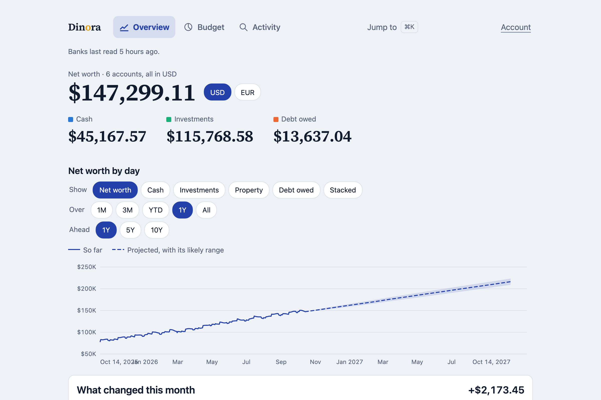
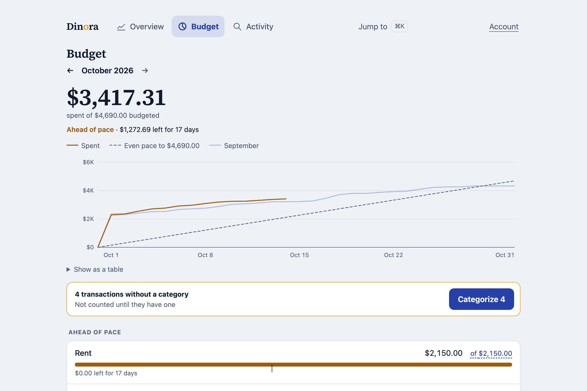
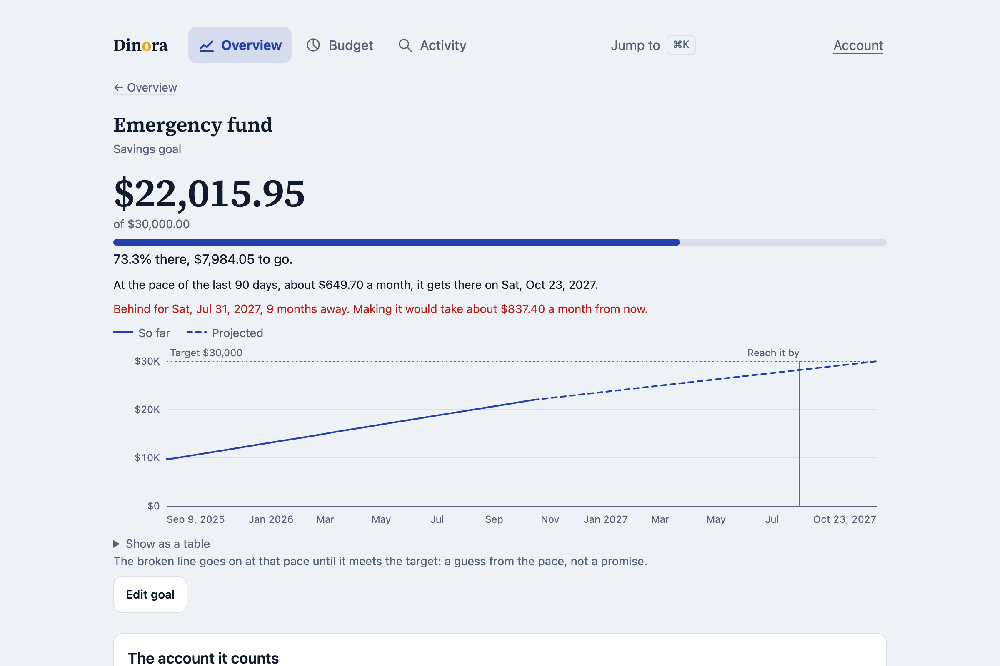
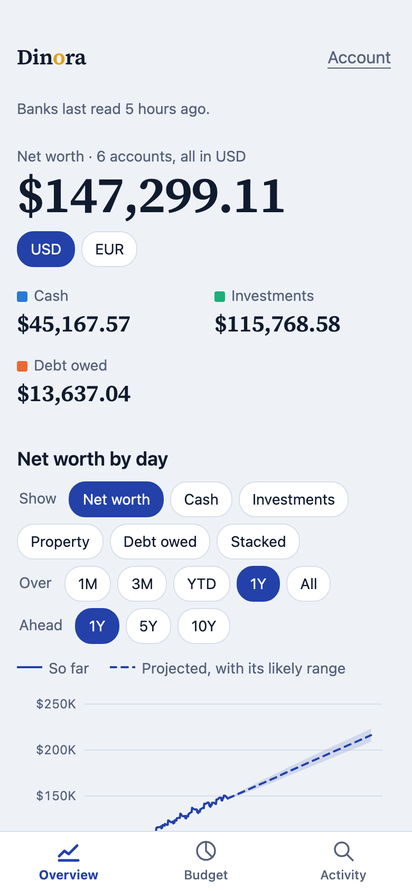

# Dinora

Every account in one place, read-only: balances, budgets, goals, projections and history.

A personal replacement for Monarch, built for one person. It reads US banks, cards and
brokerages through **SimpleFIN** and **Plaid** into one Supabase database every night, and
opens in a browser, as an installed app on a phone, and as a Mac app. It only ever reads:
nothing in it can move money. (A euro bank through Enable Banking is planned, not built; the
app already counts in dollars and euros for the assets entered by hand.)



<p>
  
  
</p>

Every figure, bank and payee in these pictures is invented: they are the local stack with
`pnpm db:demo` loaded (`supabase/demo.sql`), never a real account.

## What it does



- **Net worth over time**, by day, with what changed from one month to the next and a
  projection forward from the history it has.
- **Budgets** by category and month, with spending pace, a spending calendar, and a queue for
  whatever is uncategorized, sorted right where it is shown. Payee rules file the rest.
- **Goals** funded by named accounts, with a target date and the pace to reach it.
- **Assets entered by hand**: a home or a car valued weekly by an estimate (Rentcast,
  Marketcheck, both optional), precious metals at LBMA prices, crypto at Gemini closes.
- **Dollars and euros.** Every conversion stores the rate and its date, so last March does not
  move when today's rate does.
- **Works offline** as a PWA: it shows what it last read and says how old it is.
- **Imports a Monarch export**, and joins each Monarch account to the bank account it became.

## How it is built

TypeScript throughout, strict, with no casts and no non-null assertions (lint refuses both):
every boundary is parsed with Zod and the type is inferred from the schema.

```
packages/core   the domain, framework-free: money in integer minor units, budgets, goals,
                projections, parsing SimpleFIN and Plaid. No React, no DOM, no database,
                no Node, enforced by its tsconfig and lint. CI refuses it below 90% of
                lines (85% of branches); it stood at 99.9% and 96% on 14 Oct 2026.
apps/web        Vite + React SPA over it, installable as a PWA, rows cached in IndexedDB
apps/mac        a native macOS window (Swift, WebKit) onto the same web build
api/            Vercel functions: the nightly bank pull (Cron) and three owner-only actions
supabase/       Postgres migrations, row-level security on every table, and SQL tests of it
scripts/        CLIs for linking banks and importing, and the deploy's safety checks
```

The rules it is held to, what it will not do and its conventions are in
[`docs/architecture.md`](docs/architecture.md). The ones a reviewer may look for first:

- **Row-level security, forced and default-deny, on every table**, written from one pattern
  and checked by `pnpm db:verify` in CI, so a new table is held to rules written before it.
- **Nothing is hard-deleted**, and the sync's database role holds DELETE on nothing.
- **No amounts and no payees in any log.**
- **Read-only credentials only**, at every aggregator.
- **CI is the only way to production**, and the deploy refuses to ship code ahead of its
  schema, or into a project anyone could sign up to.

## Reading the code

Comments record why, not what: the decision, the date it was made, and the measurement it
rests on. Three habits in them will look unfamiliar:

- **Ticket keys** such as `BANK-07` or `ACCT-21` name the work item a decision came from, in
  a tracker that is not public. The comment beside one says what was decided.
- **"Invariant 4"** is the fourth invariant in [`docs/architecture.md`](docs/architecture.md).
- **Nora** is the one person it is built for, and **she** in a comment is her.
- **Noradar, Nora Bene, Kinora and CruciNora** are other apps of hers, built the same way:
  much here was measured in one of them first, and a comment that names one says so. Noradar
  reports what each project has deployed; the Mac app's shell is lifted from Noradar's and
  Kinora's.

The public copy is one commit, exported from a private repository by `scripts/public/`: that
history holds account names and figures that a snapshot can redact and two hundred commits
cannot. In the public copy, names in tests and comments that look invented (banks, places,
payees) are the export's stand-ins.

## Develop

Node at the version in `.node-version` (`fnm` switches to it on cd; pnpm refuses any other
major) and pnpm 9 (`corepack enable` picks up the version in `package.json`).

```bash
pnpm install
pnpm db:start # the local Supabase stack (Docker)
pnpm db:env   # writes apps/web/.env.local for it
pnpm db:demo  # optional: a year of invented accounts for one@example.test
pnpm dev      # the web app
pnpm gate     # what CI runs: format, lint, typecheck, tests with coverage
pnpm format   # the only command that rewrites files
```

## Run your own

Dinora is built for one person and runs as one deployment per person: your own Supabase
project, your own Vercel project, your own read-only bank connections, and exactly one
account. Nothing is shared with anyone else's copy. Wherever the docs name a host, use yours.

1. **Supabase.** Create a project and push the schema, then make the dashboard settings that
   cannot be made from the repo: the site URL, **signup off**, the sign-in code email
   template, passkeys for your host and a real SMTP sender. See
   [`docs/supabase.md`](docs/supabase.md). Afterwards, `pnpm auth:closed` and
   `SUPABASE_DB_URL=… pnpm db:verify:remote` check the result.
2. **The one owner.** Signup stays closed, and the deploy refuses a project anyone can join,
   so the account is made by hand. Go to **Authentication → Users → Add user**, enter your
   email, turn on **Auto Confirm User** and set a long random password that you will never
   type. Sign-in is by the code emailed to that address. That account owns every row, and
   there is no way to add a second user.
3. **Vercel and GitHub.** Link a Vercel project, then set the environment and the
   repository secrets as [`docs/vercel.md`](docs/vercel.md) describes: `CRON_SECRET`,
   `SUPABASE_URL` and `SUPABASE_SECRET_KEY` on Vercel, then `VERCEL_TOKEN`, `VERCEL_ORG_ID`,
   `VERCEL_PROJECT_ID`, `VITE_SUPABASE_URL` and `VITE_SUPABASE_ANON_KEY` as GitHub secrets.
   Deploys go only through CI, and stay skipped until the repository variable
   `ENABLE_VERCEL_DEPLOY=true` is set.
4. **Bank connections**, read-only at every aggregator. The nightly pull reads two:
   - **SimpleFIN Bridge**, for most US banks, cards and brokerages. Make a setup token at
     SimpleFIN, claim it once with `pnpm bank:claim`, and set the access URL it writes
     (`SIMPLEFIN_ACCESS_URL` in `.env.simplefin`) on Vercel.
   - **Plaid**, for an institution that SimpleFIN does not reach. Use your own Plaid keys
     (`pnpm plaid:keys`) and connect one read product at a time (`pnpm plaid:link <product>`).
     Then set `PLAID_CLIENT_ID`, `PLAID_SECRET`, `PLAID_ENV` and `PLAID_ACCESS_TOKENS` on
     Vercel.

   Set up either one or both. A source none of whose keys is set is skipped, and the night
   still succeeds; one with only some of its keys set fails, naming the ones missing. Never
   give either one a credential that can move money.

5. **The Mac app** (optional, needs Xcode or the Command Line Tools). Put these in `.env.mac`
   at the repository root, which is ignored:

   ```bash
   DINORA_MAC_HOME=https://your-deployment.example.net/
   DINORA_MAC_IDENTIFIER=net.example.you.dinora
   ```

   Then run `pnpm app:install`. It refuses while either value is still a placeholder. Choose
   the identifier once: WebKit files the app's session and cached rows under it, so the
   install refuses to change it without `--new-identifier`.

## License

MIT. See `LICENSE`.
